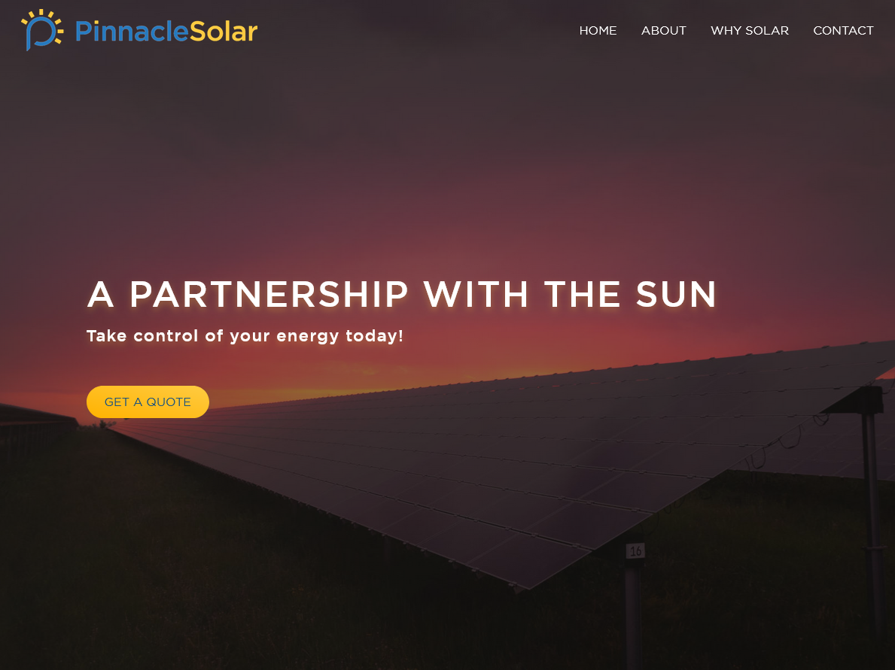
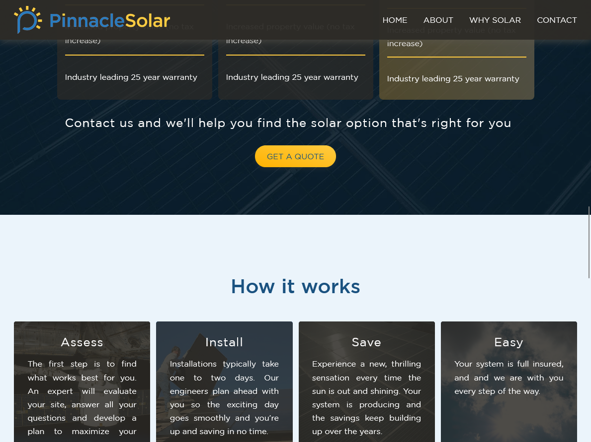
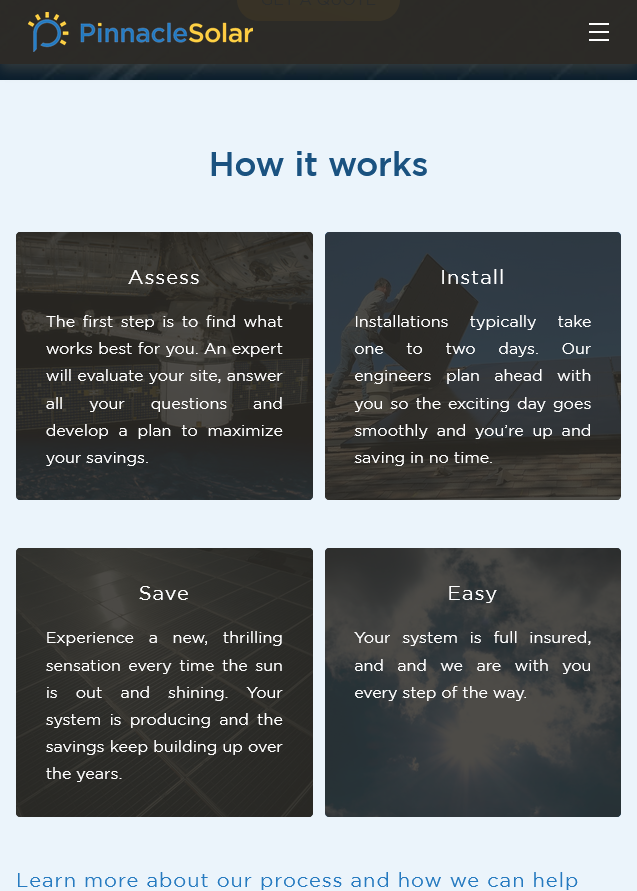

# pinnacle-solar_wp

Custom WordPress theme built for Pinnacle Solar, a solar energy consulting company serving homeowners and businesses throughout New England, based in the Berkshire Mountains of western Massachusetts.

This was my first custom-built WordPress theme — an experimental, hands-on project that established the foundation for my later freelance work.

**Demo (clone):** [solar.alexgeer.dev](https://solar.alexgeer.dev)

---

## Overview

A clean, static marketing site designed to present the company's services and financing options clearly, and to convert visitors into quote requests. No page builder — the theme was written from scratch as a learning-by-doing exercise in WordPress theme development.

---

## Tech stack

- PHP (WordPress theme API)
- HTML5 / CSS3
- JavaScript
- WordPress classic theme architecture

---

## Site structure

Four pages built on the classic WordPress template hierarchy:

- **Home** — Hero, service overview, financing options (Cash / Solar Loan / PPA), how-it-works section, lead capture CTA
- **About** — Company background and mission
- **Why Solar** — Benefits and rationale for switching to solar energy
- **Contact** — Quote request form

---

## Contact form

The contact form was connected to the company's Gmail business account via SMTP. Rather than using an off-the-shelf plugin, I built the email handler from scratch — an early example of a preference I've maintained: building things myself to understand how they work, rather than reaching for the first available plugin. A reCAPTCHA integration was added to protect the form from spam submissions.

The email plugin code was not preserved when the original hosting lapsed.

---

## Screenshots

---

## Notes

This site represents the beginning of my freelance WordPress practice. It was entirely static — no custom post types, no ACF — and focused on getting the fundamentals right: a clean PHP theme structure, responsive layout, and a working contact-to-email pipeline built without relying on existing plugins.

The client site is no longer live. A demo clone is deployed at [solar.alexgeer.dev](https://solar.alexgeer.dev).

---

## License

[GNU General Public License version 3 (GPL v3)](https://creativecommons.org/licenses/by-nc/4.0/)

---

_Built by [Alex Geer Web Design](https://alexgeer.dev)_
